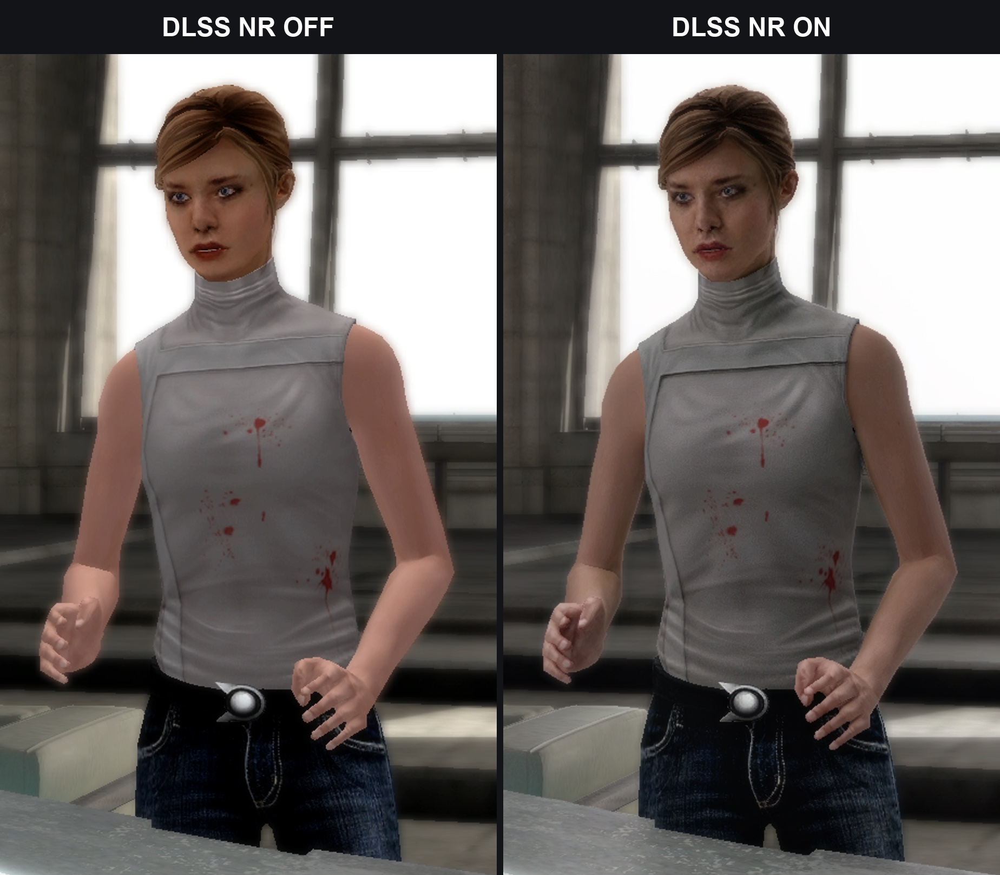
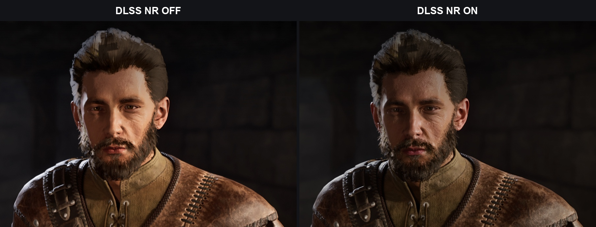
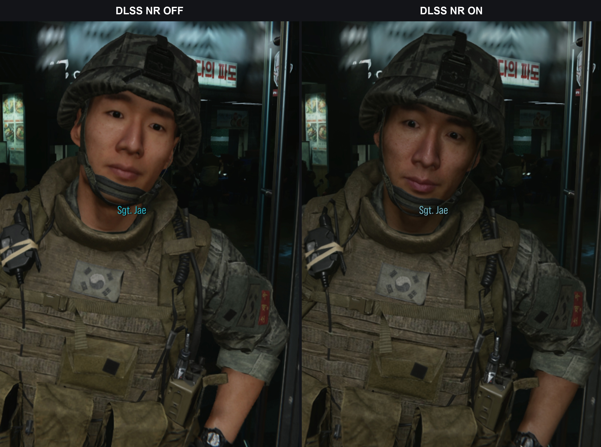
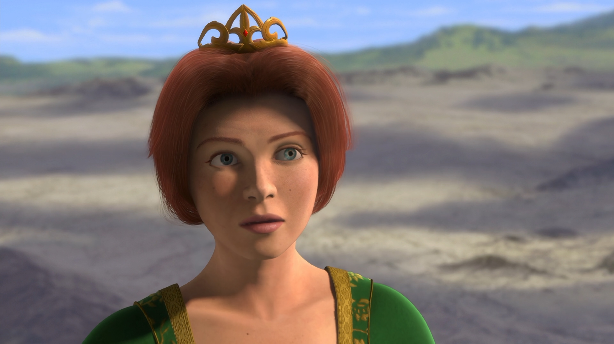
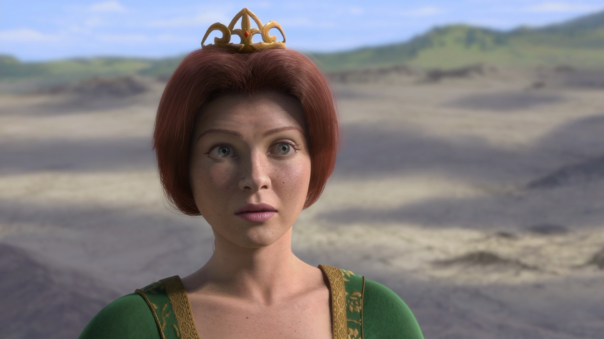
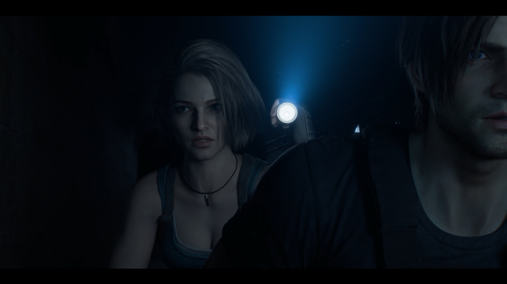
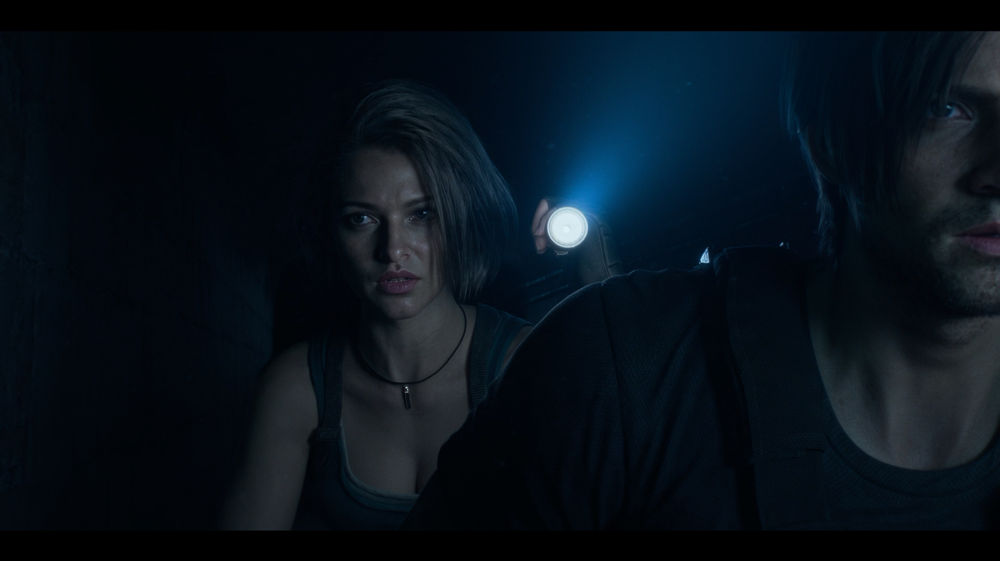

# MPC Neural Renderer

[Русский](#русский) · [English](#english)

## Русский

Нейрорендеринг видео, апскейл DLSS / FSR / XeSS и генерация кадров внутри Media Player Classic. Основа — форк [MPC Video Renderer](https://github.com/Aleksoid1978/VideoRenderer), GPL-3.0.

### Возможности и требования

- **NR**: нейрорендеринг с интенсивностью 0–200%, до апскейла, после него или в два прохода.
- **Апскейл**: DLSS SR, FSR 3.1 или XeSS; можно использовать отдельно от NR и генерации.
- **Генерация кадров**: DLSS MFG, FSR FG или XeSS FG, с ограничением множителя по возможностям GPU/драйвера и частоте дисплея.
- **Видео**: 8/10-битный SDR, HDR-источники и RTX Video HDR; pre/post-resize HLSL-шейдеры и горячие клавиши.

Для нейрофункций нужны **Windows 10/11 x64**, **MPC-HC x64**, **Direct3D 11** и совместимые GPU/драйверы. Нейрообработка использует D3D11/D3D12 на одной видеокарте. Библиотеки NVIDIA устанавливаются отдельно; необходимые библиотеки AMD/Intel и их лицензии входят в сборку. Поддержку конкретной функции проверяет её SDK. D3D9 остаётся обычным путём вывода без нейрообработки.

### Примеры

Идея проекта — попробовать нейрорендеринг в играх Nintendo Switch 2: консоль подключается через карту захвата, а MPC-HC с этим рендерером обрабатывает картинку на ПК.

**Игры Nintendo Switch 2** — пары DLSS NR OFF / ON:

**Фильмы:**

| NR выключен | NR включён |
|---|---|
|  |  |
|  |  |

### Подключение

1. Скачайте Windows x64 сборку из [GitHub Actions](https://github.com/ivderezin/MPC-NeuralRenderer/actions/workflows/main.yml) (успешный запуск для ветки **main** → **Artifacts → MPC-NeuralRenderer-Windows-x64**) или [Releases](https://github.com/ivderezin/MPC-NeuralRenderer/releases). HDR-исправления и управление шейдерами входят в релиз `v0.1.2` и более новые сборки. Распакуйте архив в постоянную папку и оставьте DLL AMD/Intel рядом с `.ax`.
2. Для функций NVIDIA скопируйте туда же нужные библиотеки: `nvngx_dlssnr.dll` — NR, `nvngx_dlss.dll` — DLSS SR, `nvngx_dlssg.dll` — DLSS MFG. Они не входят в архив.
3. Закройте плеер и запустите `Install_MPCVR_64.cmd` от администратора.
4. В MPC-HC x64 откройте **Options → External Filters → Add Filter → MPC Neural Renderer → Prefer**. Если фильтра нет в списке, нажмите **Browse** и укажите `nvngx.dll_MpcNeuralRenderer64.ax`.
5. Откройте видео или устройство захвата. Через **Play → Filters → MPC Neural Renderer** откройте настройки, включите **Use Direct3D 11** и выберите обработку:
   - **Enable neural rendering**, **Intensity** — NR, интенсивность 0–200%.
   - **NR stage** — где выполняется NR при апскейле: **Before upscaling** (на исходном кадре, быстрее всего), **After upscaling** (на увеличенном кадре) или **Before and after** (два прохода). Без апскейла NR всегда выполняется один раз на исходном кадре.
   - **Upscaling** — Off / DLSS SR / FSR 3.1 / XeSS.
   - **Motion estimation** — **Fast block matching** (по умолчанию) или **EchoStorm coarse-to-fine**. Выбор общий для NR, апскейла и DLSS / FSR / XeSS FG; сохраняется по Apply. EchoStorm добавлен после v0.1.2 — используй актуальную сборку Actions.
   - **Frame generation** — DLSS MFG / FSR FG / XeSS FG; **Multiplier** — Off / 2x / 3x / 4x.
   - **Present DLSS / FSR generated frames from a dedicated thread** — показ сгенерированных кадров из отдельного потока с очередью пакетов вместо таймера в UI-потоке плеера. Меньше опозданий и потерянных реальных кадров; задержка — до одного интервала между кадрами.
6. Нажмите **Apply**. Включите **Show statistics**, чтобы увидеть выбранные режимы, состояние обработки и причину отказа, если функция недоступна.

Апскейлер и генератор выбираются независимо: например, FSR + XeSS FG или XeSS + DLSS MFG. NR также включается отдельно. Это дополнительный DirectShow-рендерер: регистрация штатного MPC Video Renderer и настройки его вывода сохраняются. Для удаления закройте плеер и запустите `Uninstall_MPCVR_64.cmd` от администратора.

### Апскейл и генерация

Апскейл включается, только когда исходный кадр меньше разрешения монитора и области вывода: 1080p → 4K увеличивается, 4K → 4K — нет. NR получает полное исходное изображение. При выключенном или недоступном нейроапскейлере обычное масштабирование рендерера продолжает заполнять область просмотра с пропорциями, выбранными в плеере; уменьшение для размещения в окне также сохраняется. Исключение — экспериментальный режим FSR native AA для AMD-моста: он вызывает FSR и при 1:1.

FSR 3.1 FG поддерживает **2x**. DLSS и XeSS используют доступный GPU / драйверу множитель в пределах выбранного. Частота монитора дополнительно ограничивает генерацию: для 60 FPS на 160 Гц максимум 2x. Для DLSS MFG нужны совместимая RTX, драйвер NVIDIA и включённое аппаратное планирование GPU (HAGS). Для XeSS FG используется D3D12 swap chain и XeLL; включайте его в оконном или безрамочном режиме с 8-битным SDR-выводом. Поддержку конкретного GPU проверяет SDK выбранного провайдера.

Генерация работает без апскейла. При перемотке, паузе и смене размера история сбрасывается. Входные кадры не накапливаются в очереди нейрообработки: пока GPU занят, используется последний готовый кадр. Очередь показа сгенерированных кадров ограничена отдельно; выделенный поток показа включён по умолчанию. Ошибка провайдера отображается в статистике, без автоматического переключения на другой алгоритм.

### SDR, HDR и порядок обработки

| Режим | NR / SR | DLSS MFG / FSR FG | XeSS FG |
|---|---|---|---|
| 8/10-битный SDR | Поддерживается, вход модели — 8-битный SDR | Поддерживается | Нужен 8-битный SDR-вывод |
| HDR10 / HLG / Dolby Vision → HDR | SDR-представление с восстановлением HDR | Восстановленный 10-битный PQ / BT.2020 | HDR-вывод не поддерживается |
| RTX Video HDR → HDR | Тот же HDR-путь | Тот же HDR-путь | HDR-вывод не поддерживается |
| HDR → SDR | После встроенного тонмаппинга | SDR-кадр после обработки | Только при 8-битном SDR-выводе |

Работа исправления HDR подтверждена пользователем проекта; Windows-сборка и GPU-регрессии проходят CI. Это подтверждение конкретной проверенной конфигурации, а не всех комбинаций видеокарт, драйверов и HDR-форматов.

При включённой нейрообработке порядок такой: **RGB-преобразование и цветовые коррекции → pre-resize шейдеры → NR до апскейла (если выбран) → апскейл → NR после апскейла (если выбран) → восстановление HDR (при HDR-выводе) → DLSS/FSR FG → масштабирование для вывода, post-resize шейдеры и субтитры**. XeSS FG использует собственный путь презентации. Уже выполненные цветовые коррекции не повторяются при показе готовых кадров.

Оба прохода NR увеличивают нагрузку, особенно когда второй обрабатывает 4K. Без увеличения разрешения встроенный NR выполняется один раз независимо от NR stage.

### Данные видео и ограничения

- Нейрообработка доступна для Windows x64 и SDR, включая 10-битные SDR-видео и внутренние RGB-текстуры 8-bit / RGB10A2 / float16. Перед NR, SR и DLSS/FSR FG RGB нормализуется в 8-битный SDR-вход модели: исходная 10-битная точность на этом этапе не сохраняется.
- HDR10, HLG, Dolby Vision и RTX Video HDR проходят цветовые преобразования рендерера до нейрообработки. При HDR-выводе модель NR / SR получает SDR-представление кадра, а её изменения возвращаются на исходный HDR в линейном свете. Неизменённое представление сохраняет исходные яркость и широкий цветовой охват; выход восстанавливается в 10-битный PQ / BT.2020. DLSS MFG и FSR FG затем работают уже с восстановленным HDR-кадром и соответствующими HDR-параметрами. Это обработка через SDR-представление, а не нативный HDR-вход модели NR/SR.
- При HDR → SDR нейрообработка выполняется после встроенного тонмаппинга; коррекции не применяются повторно к готовым и сгенерированным кадрам. XeSS FG по-прежнему требует 8-битного SDR swap chain. Стереопреобразование обходит нейрообработку. GPU-тесты проверяют HDR-математику, сохранение чёрного, светов и BT.2020, восстановление после апскейла и перенос изменений модели. При проблемах на другой конфигурации приложите к issue версию сборки, GPU/драйвер, режим HDR и скриншот статистики.
- Векторы движения оцениваются по изображению на GPU. Fast использует поиск ±16 пикселей с шагом 4; опциональный EchoStorm использует пирамиду яркости, общий сдвиг камеры, поиск от грубого масштаба к точному, субпиксельное уточнение и фильтрацию. Маска недоверия EchoStorm помогает DLSS SR отбрасывать ненадёжную историю. EchoStorm требует больше GPU-работы; выигрыш в качестве и стоимость зависят от видео и видеокарты. Данных о глубине нет — используется нулевая текстура. Векторы и глубина игрового движка через видеозахват не передаются.
- Положение NR задаёт NR stage: исходное разрешение, выходное разрешение или оба. FSR и XeSS SR получают линейное представление входа модели. DLSS / FSR FG показывают готовые кадры по расписанию рендерера, XeSS FG управляет показом через свой swap chain.
- NR использует NGX Feature 18. Имя `.ax` содержит `nvngx.dll` для совместимости с проверкой вызывающего модуля в модели 310.8.0.0; патчей памяти и перехватов функций нет.

### Пиксельные шейдеры

В свойствах **MPC Neural Renderer → Pixel shaders** доступны **Add pre-resize…**, **Add post-resize…** и **Clear** для каждого этапа. Открой видео, выбери самостоятельный HLSL-файл (UTF-8, `main`, `ps_4_0`). Добавление дописывает шейдер в цепочку; Clear очищает выбранную цепочку. Изменения применяются сразу, включая при нажатии Cancel в свойствах, и действуют до пересоздания графа/устройства; пресеты в плеере они не сохраняют. Доступно в D3D11.

Pre-resize выполняется после преобразования видео в RGB, перед NR и апскейлом; post-resize — после масштабирования и встроенных цветовых коррекций. Пиксельные шейдеры работают и с HDR; при включённой нейрообработке встроенные цветовые коррекции выполняются перед pre-resize. При HDR шейдер должен учитывать цветовое пространство своего этапа.

Меню **Pre-Resize / Post-Resize Pixel Shaders** самого MPC-HC зависит от выбранного в плеере типа рендерера и его адаптера. Установка нашего фильтра через External Filters не подключает встроенный адаптер MPC-VR, поэтому это меню может быть недоступно. Эксклюзивного захвата этапов рендерер не требует: для внешнего фильтра используй кнопки в его свойствах.

### Горячие клавиши

В активном окне плеера (D3D11, Windows x64):

| Клавиши | Действие |
|---|---|
| Ctrl+Alt+U | Включить / выключить выбранный апскейлер |
| Ctrl+Alt+N | Включить / выключить встроенный NR |
| Ctrl+Alt+G | Включить / выключить генерацию кадров |
| Ctrl+Alt+R | Приостановить / возобновить всю нейрообработку |

При повторном включении восстанавливаются последний апскейлер и множитель (по умолчанию DLSS и 2x). Первые три переключения сохраняются в настройках; общая приостановка действует до закрытия рендерера. Видео продолжает заполнять область просмотра с сохранением выбранных плеером пропорций, даже когда апскейлер выключен. Короткое сообщение показывает выбранный режим; фактическую доступность функций смотри в статистике. Сочетания освобождаются, когда окно плеера теряет фокус; занятое другим приложением сочетание может быть недоступно.

### AMDLSS5 (экспериментально)

**Экспериментальные входы для [AMDLSS5](https://github.com/Wehaveall/AMDLSS5):** установи мод отдельно для `mpc-hc64.exe` через его установщик, выбери **FSR 3.1**, включи **AMDLSS5 bridge: FSR native AA (experimental)** и выключи встроенный NVIDIA NR. Рендерер будет вызывать FSR и при 1:1 (например, 4K → 4K). В этом режиме `amd_fidelityfx_upscaler_dx12.dll` из папки плеера имеет приоритет; если её там нет, используется DLL рядом с фильтром. Внешний NR управляется самим модом: **F10**, меню — **End**; Ctrl+Alt+N управляет только встроенным NR. Ctrl+Alt+U / R прекращают подачу кадров в FSR и внешний NR.

Это подготовка входов для внешнего мода, совместимость с MPC-HC пока не подтверждена. AMDLSS5 заявляет RX 9070 / 9070 XT и D3D12; наш вывод использует D3D11, поэтому перехват FSR и работа оверлея требуют проверки на Radeon. Файлы и код мода не входят в поставку рендерера.

### Сборка и тесты

1. Установите Visual Studio 2022 с **Desktop development with C++**, MFC, ATL и Windows SDK.
2. Выполните `powershell -ExecutionPolicy Bypass -File tools/Build.ps1`. Скрипт загрузит закреплённые SDK, проверит SHA-256, соберёт рендерер и скопирует DLL AMD / Intel с лицензиями.
3. Готовые файлы: `_bin/Filter_x64/`. Для сборки через Visual Studio предварительно выполните `tools/Fetch-NgxSdk.ps1` и `tools/Fetch-VendorSdks.ps1`, затем выберите **Release | x64**.
4. `tools\Test.cmd` проверяет историю кадров, настройки и миграцию, условия апскейла, расписание генерации, таймер и отдельный поток показа, движение и обрезку кадра, нормализацию 10-битного SDR, HDR-композицию через D3D11 WARP и преобразование цвета через D3D12 WARP. Эти же проверки и Release x64 сборка выполняются в GitHub Actions.

`Source/Upscaling` — апскейлеры; `Source/FrameGeneration` — генераторы и вывод; `Source/Processing` — провайдеры, загрузка библиотек и цвет; `Source/NeuralRendering` — NR, история и координация обработки. Всё выполняется в процессе плеера.

Происхождение исходников и лицензии: [docs/upstream.md](https://github.com/ivderezin/MPC-NeuralRenderer/blob/main/docs/upstream.md). Исходная документация: [docs/upstream-readme.md](https://github.com/ivderezin/MPC-NeuralRenderer/blob/main/docs/upstream-readme.md).

## English

Video neural rendering, DLSS / FSR / XeSS upscaling, and frame generation inside Media Player Classic. Based on a fork of [MPC Video Renderer](https://github.com/Aleksoid1978/VideoRenderer), GPL-3.0.

### Features and requirements

- **NR**: neural rendering with 0–200% intensity, before upscaling, after it, or in two passes.
- **Upscaling**: DLSS SR, FSR 3.1, or XeSS, independently of NR and frame generation.
- **Frame generation**: DLSS MFG, FSR FG, or XeSS FG, capped by GPU/driver capabilities and display refresh rate.
- **Video**: 8/10-bit SDR, HDR sources, and RTX Video HDR; pre/post-resize HLSL shaders and hotkeys.

Neural features require **Windows 10/11 x64**, **MPC-HC x64**, **Direct3D 11**, and compatible GPU/drivers. Neural processing uses D3D11/D3D12 on the same GPU. NVIDIA libraries are supplied separately; required AMD/Intel libraries and licenses are bundled. Each provider's SDK checks feature support. D3D9 remains available for ordinary rendering without neural processing.

### Examples

The project started from wanting to try neural rendering in Nintendo Switch 2 games: the console connects through a capture card, and MPC-HC with this renderer processes the image on the PC.

**Nintendo Switch 2 games** — DLSS NR OFF / ON pairs:

**Films:**

| NR off | NR on |
|---|---|
|  |  |
|  |  |

### Setup

1. Download a Windows x64 build from [GitHub Actions](https://github.com/ivderezin/MPC-NeuralRenderer/actions/workflows/main.yml) (a successful **main** run → **Artifacts → MPC-NeuralRenderer-Windows-x64**) or [Releases](https://github.com/ivderezin/MPC-NeuralRenderer/releases). The HDR fixes and shader controls are included in release `v0.1.2` and later builds. Extract to a permanent folder and keep the AMD/Intel DLLs beside the `.ax` file.
2. For NVIDIA features, copy the required libraries into the same folder: `nvngx_dlssnr.dll` for NR, `nvngx_dlss.dll` for DLSS SR, and `nvngx_dlssg.dll` for DLSS MFG. These libraries are not included in the archive.
3. Close the player and run `Install_MPCVR_64.cmd` as administrator.
4. In MPC-HC x64, open **Options → External Filters → Add Filter → MPC Neural Renderer → Prefer**. If the filter is missing, click **Browse** and select `nvngx.dll_MpcNeuralRenderer64.ax`.
5. Open a video or capture device. Open the renderer settings through **Play → Filters → MPC Neural Renderer**, enable **Use Direct3D 11**, and choose the processing options:
   - **Enable neural rendering**, **Intensity** — NR with 0–200% intensity.
   - **NR stage** — where NR runs when upscaling: **Before upscaling** (on the source frame, fastest), **After upscaling** (on the upscaled frame), or **Before and after** (two passes). Without upscaling, NR always runs once on the source frame.
   - **Upscaling** — Off / DLSS SR / FSR 3.1 / XeSS.
   - **Motion estimation** — **Fast block matching** (default) or **EchoStorm coarse-to-fine**. Applies to NR, upscaling, and DLSS / FSR / XeSS FG; saved with Apply. EchoStorm was added after v0.1.2; use a current Actions build.
   - **Frame generation** — DLSS MFG / FSR FG / XeSS FG; **Multiplier** — Off / 2x / 3x / 4x.
   - **Present DLSS / FSR generated frames from a dedicated thread** — presents generated frames from a dedicated thread with a queued schedule instead of a timer on the player's UI thread. Fewer late and dropped real frames, at up to one frame interval of extra latency.
6. Click **Apply**. Enable **Show statistics** to see the selected modes, processing status, and the reason if a feature is unavailable.

Select the upscaler and frame generator independently: for example, FSR + XeSS FG or XeSS + DLSS MFG. NR is also enabled separately. This is an additional DirectShow renderer: the stock MPC Video Renderer registration and output settings are preserved. To uninstall, close the player and run `Uninstall_MPCVR_64.cmd` as administrator.

### Upscaling and frame generation

Upscaling runs only when the source frame is smaller than both the monitor resolution and the output area: 1080p → 4K is upscaled; 4K → 4K is not. NR receives the full source image. With neural upscaling disabled or unavailable, the renderer uses ordinary resizing to fill the viewport according to the player's aspect ratio setting; downscaling to fit the window remains available. Experimental FSR native AA for the AMD bridge is an exception: it also dispatches FSR at 1:1.

FSR 3.1 FG supports **2x**. DLSS and XeSS use the GPU / driver-supported multiplier, up to the selected value. The monitor refresh rate further limits generation: 60 FPS on a 160 Hz display allows up to 2x. DLSS MFG requires a compatible RTX GPU, an NVIDIA driver, and Hardware-Accelerated GPU Scheduling (HAGS). XeSS FG uses a D3D12 swap chain and XeLL; use windowed or borderless mode with 8-bit SDR output. The selected provider's SDK checks GPU support.

Frame generation works without upscaling. Seeking, pausing, and resizing reset the history. Input frames do not build up an inference queue: while the GPU is busy, the latest completed frame is used. Generated-frame presentation has its own bounded queue; dedicated-thread presentation is enabled by default. Provider errors appear in the statistics without automatically switching to another algorithm.

### SDR, HDR, and processing order

| Mode | NR / SR | DLSS MFG / FSR FG | XeSS FG |
|---|---|---|---|
| 8/10-bit SDR | Supported; the model receives 8-bit SDR | Supported | Requires 8-bit SDR output |
| HDR10 / HLG / Dolby Vision → HDR | SDR proxy with HDR reconstruction | Restored 10-bit PQ / BT.2020 | HDR output unsupported |
| RTX Video HDR → HDR | Same HDR path | Same HDR path | HDR output unsupported |
| HDR → SDR | After built-in tone mapping | Processed SDR frame | Only with 8-bit SDR output |

The project's user has confirmed the HDR fix works; the Windows build and GPU regressions pass CI. This validates the tested configuration, rather than every GPU, driver, and HDR-format combination.

With neural processing enabled, the order is: **RGB conversion and colour correction → pre-resize shaders → pre-upscale NR (if selected) → upscaling → post-upscale NR (if selected) → HDR reconstruction (for HDR output) → DLSS/FSR FG → output resizing, post-resize shaders, and subtitles**. XeSS FG uses its own presentation path. Completed frames do not receive the same colour corrections twice.

Both NR passes increase GPU load, especially when the second processes 4K. Without increased resolution, built-in NR runs once regardless of NR stage.

### Video inputs and limitations

- Neural processing supports Windows x64 SDR, including 10-bit SDR video and 8-bit / RGB10A2 / float16 RGB internal textures. Before NR, SR, and DLSS/FSR FG, RGB is normalized into an 8-bit SDR model input; original 10-bit precision is not retained at that stage.
- HDR10, HLG, Dolby Vision, and RTX Video HDR pass through the renderer's colour conversion before neural processing. With HDR output, NR/SR receive an SDR proxy; their changes are composited onto the original HDR frame in linear light. An unchanged proxy preserves original luminance and wide gamut; output is restored to 10-bit PQ / BT.2020. DLSS MFG and FSR FG then process the restored HDR frame using the appropriate HDR settings. This uses an SDR proxy, rather than native HDR input to NR/SR.
- For HDR → SDR output, neural processing runs after built-in tone mapping; colour corrections are not applied twice to completed/generated frames. XeSS FG still requires an 8-bit SDR swap chain. Stereo conversion bypasses neural processing. GPU tests cover HDR colour math, black/highlight/BT.2020 preservation, reconstruction after upscaling, and model residuals. For problems on another configuration, include the build version, GPU/driver, HDR mode, and a statistics screenshot in the issue.
- Motion vectors are estimated from the image on the GPU. Fast searches ±16 pixels in four-pixel steps; optional EchoStorm uses a luma pyramid, global camera shift, coarse-to-fine search, subpixel refinement, and filtering. Its distrust mask helps DLSS SR reject unreliable history. EchoStorm requires more GPU work; quality gains and cost depend on footage and GPU. No depth data is available, so a zero-filled texture is used. Video capture does not carry the game engine's motion vectors or depth.
- NR stage selects source resolution, output resolution, or both. FSR and XeSS SR receive a linear representation of the model input. DLSS / FSR FG use the renderer's presentation schedule; XeSS FG manages presentation through its own swap chain.
- NR uses NGX Feature 18. The `.ax` filename contains `nvngx.dll` for compatibility with the calling-module check in model 310.8.0.0; no memory patches or function hooks are used.

### Pixel shaders

Open **MPC Neural Renderer properties → Pixel shaders** for **Add pre-resize…**, **Add post-resize…**, and **Clear** for each stage. Open a video first, then choose a standalone HLSL file (UTF-8, `main`, `ps_4_0`). Add appends to the chain; Clear removes that stage's chain. Changes apply immediately, including when cancelling the properties dialog, and last until the graph/device is recreated; they are not saved as player presets. D3D11 only.

Pre-resize runs after RGB conversion, before NR and upscaling; post-resize runs after scaling and built-in colour corrections. Pixel shaders also work with HDR; built-in colour corrections run before pre-resize when neural processing is enabled. HDR shaders must account for their stage's colour space.

MPC-HC's own **Pre-Resize / Post-Resize Pixel Shaders** menu depends on its configured renderer type and adapter. Loading our filter through External Filters does not attach the built-in MPC-VR adapter, so that menu can be unavailable. The renderer does not require exclusive control of these stages; use its property-page buttons in external-filter mode.

### Hotkeys

With the player window active (D3D11, Windows x64):

| Shortcut | Action |
|---|---|
| Ctrl+Alt+U | Toggle the selected upscaler |
| Ctrl+Alt+N | Toggle built-in NR |
| Ctrl+Alt+G | Toggle frame generation |
| Ctrl+Alt+R | Suspend / resume all neural processing |

Re-enabling restores the last upscaler and multiplier (initially DLSS and 2x). The first three toggles save settings; suspension lasts until the renderer closes. Video keeps filling the viewport according to the player's aspect ratio setting with upscaling off. A brief message reports the selection; statistics show actual availability. Shortcuts are released when the player loses focus; a combination owned by another application may be unavailable.

### AMDLSS5 (experimental)

**Experimental inputs for [AMDLSS5](https://github.com/Wehaveall/AMDLSS5):** install the mod separately for `mpc-hc64.exe` using its installer, select **FSR 3.1**, enable **AMDLSS5 bridge: FSR native AA (experimental)**, and disable built-in NVIDIA NR. FSR will also run at 1:1 (e.g. 4K → 4K). In this mode, `amd_fidelityfx_upscaler_dx12.dll` in the player's folder takes precedence over the DLL beside the filter. External NR uses the mod's **F10** toggle and **End** menu; Ctrl+Alt+N controls built-in NR only. Ctrl+Alt+U / R stop feeding FSR and external NR.

This prepares inputs for an external mod; MPC-HC compatibility is unverified. AMDLSS5 lists RX 9070 / 9070 XT and D3D12; our presentation uses D3D11, so FSR interception and overlay support need Radeon testing. The renderer does not bundle the mod's code or files.

### Building and testing

1. Install Visual Studio 2022 with **Desktop development with C++**, MFC, ATL, and the Windows SDK.
2. Run `powershell -ExecutionPolicy Bypass -File tools/Build.ps1`. The script downloads pinned SDK files, verifies SHA-256 hashes, builds the renderer, and copies the AMD / Intel DLLs with their licenses.
3. Build output: `_bin/Filter_x64/`. To build in Visual Studio, first run `tools/Fetch-NgxSdk.ps1` and `tools/Fetch-VendorSdks.ps1`, then select **Release | x64**.
4. `tools\Test.cmd` checks frame history, settings and migration, upscaling conditions, frame-generation scheduling, the presentation timer and dedicated thread, motion/cropping, 10-bit SDR normalization, HDR compositing through D3D11 WARP, and colour conversion through D3D12 WARP. GitHub Actions runs the same checks and Release x64 build.

`Source/Upscaling` contains upscalers; `Source/FrameGeneration` contains generators and presentation; `Source/Processing` contains provider selection, library loading, and color conversion; `Source/NeuralRendering` contains NR, history, and processing coordination. Everything runs inside the player process.

Source provenance and licenses: [docs/upstream.md](https://github.com/ivderezin/MPC-NeuralRenderer/blob/main/docs/upstream.md). Original documentation: [docs/upstream-readme.md](https://github.com/ivderezin/MPC-NeuralRenderer/blob/main/docs/upstream-readme.md).
